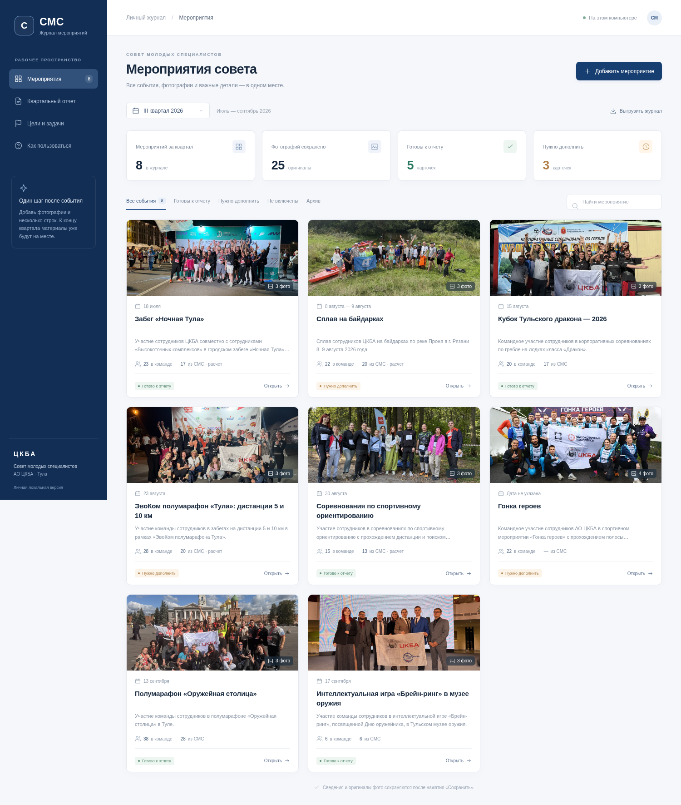
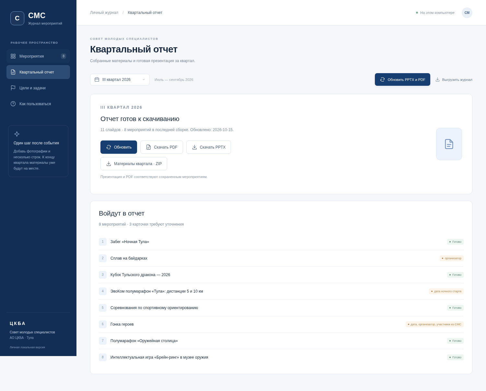

# Личный журнал СМС АО ЦКБА

Сайт для одного пользователя: мероприятия, фотографии, показатели и квартальные отчеты. В разделе «Квартальный отчет» доступны презентация за III квартал 2026 года и соответствующий PDF — по 11 слайдов.



## Запуск

Скачайте **весь репозиторий** через Code → Download ZIP и распакуйте архив. Нужен Python 3.10 или новее.

**Windows:** дважды нажмите `START-WINDOWS.bat` в корне. При первом запуске программа создаст отдельное окружение `webapp/.venv` и установит библиотеки отчета; для этого нужен интернет. Затем браузер откроется автоматически.

**macOS / Linux:** из папки репозитория:

```sh
python3 -m venv webapp/.venv
webapp/.venv/bin/python -m pip install -r webapp/requirements.txt
webapp/.venv/bin/python webapp/server.py --open
```

Адрес: **http://127.0.0.1:8765** на том же компьютере. Окно сервера оставьте открытым. Остановка — Ctrl+C.

Для просмотра и редактирования без установки библиотек можно по-прежнему выполнить `python3 webapp/server.py --open`; сборка отчета в этом случае потребует установить зависимости.

## Обновить презентацию и PDF

1. Отредактируйте мероприятие, добавьте фотографии или измените состав отчета и нажмите «Сохранить».
2. Сайт предложит **«Обновить презентацию и PDF?»**. Нажмите **«Обновить»** в предложении или в разделе «Квартальный отчет». Кнопка **«Обновить PPTX и PDF»** также всегда видна наверху страницы, рядом с выбором квартала.
3. Дождитесь окончания сборки. Скачайте новые PPTX и PDF в разделе отчета.



Для создания PDF нужен бесплатный **[LibreOffice](https://www.libreoffice.org/download/download-libreoffice/)**. В Windows также поддерживается установленный Microsoft PowerPoint; при наличии обеих программ используется LibreOffice. После установки программа обнаруживается при следующем нажатии «Обновить»; при необходимости перезапустите сайт. Нестандартный путь к LibreOffice задается переменной окружения `SMS_SOFFICE` — полный путь к `soffice` или `soffice.exe`.

Текущая пересборка поддерживает III квартал 2026 года, для которого уже есть оформленный шаблон. Для первого отчета другого квартала агент подготавливает шаблон и план. Сборка сохраняет титульные фотографии, логотипы, цвета, изгиб фотоколлажа, слайды информирования и предложений. Групповой снимок находится в центре. Длинный текст переносится на дополнительные слайды; неизвестные значения остаются прочерками. При недоступности Verdana программа просмотра использует замену шрифта; установите Verdana для точного воспроизведения оформления.

Во время обновления предыдущая пара файлов доступна для скачивания. Новая пара появляется только после успешного создания и проверки обоих файлов. Ошибка экспорта не уничтожает предыдущий отчет. Если редактировать карточки во время сборки, сайт сохранит правки и предложит обновить отчет еще раз. Учитываются также архивирование, исключение и перенос мероприятия в другой квартал. Повторное нажатие во время сборки не создает вторую задачу.

## Возможности журнала

- При первом запуске импортируются журнал, оригиналы фотографий и предложения плана из `presentations/`. Восемь мероприятий III квартала включены в отчет; исключенная эстафета хранится отдельно.
- Карточки по кварталам, поиск и фильтры готовности, исключенных и архивных мероприятий.
- Название, даты, организатор, описание, эффект, численность команды и СМС, источник и формула расчета, заметки, включение в отчет.
- Несколько JPG, PNG или WebP, до 20 МиБ каждый и до 30 снимков в карточке; выбор общего фото. Оригиналы не растягиваются и не перезаписываются. Повторная загрузка одного файла в карточку не создает дубль.
- Проверка дат и кварталов, целых неотрицательных количеств и соотношения СМС и команды. Для расчетных значений требуется основание. Неизвестные поля можно оставить пустыми.
- Архивирование с восстановлением. Удаление фото из карточки не стирает исходный файл.
- Выгрузка журнала JSON и материалов квартала ZIP с фотографиями, планом и источниками показателей.
- Защита от потери правок при редактировании в разных вкладках.

## Данные и резервные копии

### Если после обновления нет кнопки

Если в разделе отчета написано «Отчет уже собран» и «Передайте агенту новую выгрузку», открыт прежний интерфейс. Сначала попробуйте **Ctrl + Shift + R**. Если надписи остались, обновите файлы программы:

1. Остановите старый сервер: Ctrl+C в его окне, затем закройте это окно.
2. Скопируйте прежнюю папку `webapp/.data` в надежное место — в ней ваши правки и загруженные фотографии.
3. Скачайте и распакуйте свежий архив репозитория.
4. Поместите сохраненную `.data` в `webapp/` новой версии **до первого запуска**.
5. Запустите `START-WINDOWS.bat` из новой папки и откройте http://127.0.0.1:8765.
6. Нажмите Ctrl + Shift + R. Наверху появится кнопка «Обновить PPTX и PDF».

Приложение исправляет пути к фотографиям при переносе `.data` в новую папку. HTML, JavaScript и стили теперь выдаются без кэширования.

Изменения хранятся в `webapp/.data/`: база `journal.sqlite3`, новые оригиналы в `uploads/`, уменьшенные копии в `thumbnails/`, версии отчетов в `reports/`. Папка исключена из Git. Для полной резервной копии остановите сервер и сохраните всю `.data/`. Архив квартала содержит сведения и используемые фото.

Начальные данные импортируются один раз. Правки не перезаписываются при следующем запуске. Сайт не меняет автоматически `presentations/events.json` и исходные отчеты в Git: обновленные файлы доступны через кнопки скачивания и хранятся в `.data/reports/`. Для обновления репозитория агентом передайте выгрузку квартала. При скачивании новой версии кода сохраните свою прежнюю папку `.data/` и перенесите ее в `webapp/` новой версии **до запуска**.

Другие порт и каталог данных:

```sh
python3 webapp/server.py --port 8766 --data-dir /путь/к/данным
```

Сервер слушает только `127.0.0.1`; это личная локальная версия без интернет-публикации. Доступ по закрытой интернет-ссылке отдельно не настроен.

## Проверка

```sh
python3 -m unittest discover -s webapp -p 'test_*.py' -v
node --check webapp/static/app.js
```

Проверки охватывают импорт и сохранение данных, валидацию и конфликты версий, фото и ZIP, архивирование, доступ к готовым файлам, определение изменений отчета, перенос между кварталами, пересборку и сохранение пары файлов после перезапуска, ошибки экспорта и редактирование во время сборки. Интеграционная проверка реальных PPTX и PDF запускается при установленных библиотеках и LibreOffice/PowerPoint, иначе помечается как пропущенная. Рабочие данные пользователя не затрагиваются.

Версия с обновлением проверена в Chromium: сохранение карточки, появление предложения, нажатие «Обновить», завершение реальной сборки и наличие нового текста в обоих файлах. Запросы браузера направлялись в настоящий HTTP-обработчик в памяти; открытие TCP-порта не требовалось. Ошибок JavaScript не обнаружено. Текущие 11 слайдов визуально сверены с прежним отчетом; текст, фотографии и кадрирование сохранены.
